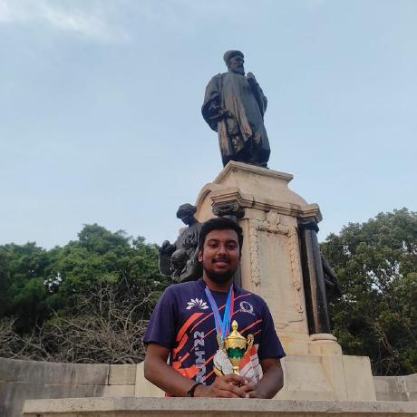

**Nikhesh Kumar Murali** (he/him) · previously @ IISc, IIT Madras · Hyderabad, India · Virtusa Corp · [nikheshk19@gmail.com](mailto:nikheshk19@gmail.com) · [GitHub](https://github.com/NikheshKumar) · [Goodreads](https://www.goodreads.com/user/show/82922299)

Welcome to my personal webpage. I am currently an Associate Data Scientist at [Virtusa Corp](https://www.virtusa.com/), India.

I previously majored in mathematics as an undergraduate at [IISc Bengaluru](https://iisc.ac.in/), where my bachelor’s project focused on metric geometry. I later explored Fuchsian groups and hyperbolic geometry for my integrated master’s project. I completed my master’s degree in Data Science and Artificial Intelligence from [IIT Madras](https://www.iitm.ac.in/) and the [University of Birmingham](https://www.birmingham.ac.uk/), UK.

My current research interests are in AI safety, especially the alignment problem, mechanistic interpretability, and reinforcement learning. I watch football, tennis and F1 religiously, and listen to indie dream pop/prog metal. I try to read books, both fiction and non-fiction in my free time. I used to think about solving the GRH, but anyways AGI is coming for us though xD.
